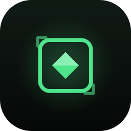

<p align="center"></p>

<h1 align="center">XRecomp</h1>

<p align="center"><b>Original Xbox games, statically recompiled to native code.</b><br>
Play them on Android, macOS, Linux or Windows. Prepare them on the device itself or on a desktop.</p>

XRecomp turns the x86 code of an Xbox game (`default.xbe`) into C, compiles it for your machine and runs it against
a runtime that stands in for the Xbox kernel, GPU, audio and pads. No emulator, no JIT. It is a fork of
[xboxrecomp](https://github.com/sp00nznet/xboxrecomp) that adds an Android host, launcher apps and a one-step
**Prepare**.

- **Bring your own disc.** You point it at a game you dumped from your own disc. No game data is in this repository,
  the apps or CI, and nothing you prepare leaves your machine.
- **Prepare once.** Prepare analyses the XBE, lifts it to C and builds it, all in one command. On a phone or handheld,
  the app does it with no PC (about 20–30 min, once per game).
- **Play.** You get a native build of the game, started from a launcher (Android, Mac) or from the command line.

> **Status: experimental.** Few games get far yet. What works for each game is in
> [`profiles/titles/*/`](profiles/titles/) (`title.json` « status », `NOTES.md`). Expect crashes, and expect to
> prepare a game again after an update.

## Platforms

| Platform | Play | Prepare | Front end |
|---|---|---|---|
| **Android** arm64, Android 11+, GLES 3.0 | ✅ AYN Thor first | ✅ on the device | XRecomp app: launcher, gamepad UI, dual screen |
| **macOS** Apple Silicon / Intel | ✅ SDL2 + OpenGL | ✅ | XRecomp.app launcher, or the command line |
| **Linux** x86-64 / arm64 | ✅ SDL2 + OpenGL | ✅ | command line |
| **Windows** x86-64 | ⚠️ upstream route (MSVC, D3D11) | ⚠️ manual pipeline | command line |

Linux x86-64 and arm64 are tested by CI on every push. On Windows, the upstream route has not been tested by this
fork. A game runs on Linux arm64 before we debug it on Android.

**Other consoles.** `consoles/` holds the start of Game Boy Advance, PlayStation and Nintendo 64 support: the
layout, the CMake options and a homebrew test corpus. The runtimes are still empty, so no game for these consoles
runs yet ([consoles/README.md](consoles/README.md)).

## Get it

### Android

1. Install `xrecomp-<commit>.apk` from the release
   [xrecomp-latest](https://git.cf.adserver.fr/Alex/xboxrecomp-android/releases/tag/xrecomp-latest). CI builds it from
   `main`, and each build updates the previous one in place.
2. In the app, add an extracted game folder or an ISO, then press **Prepare**. When it finishes, press **Play**.

Some docs to go further:
- [app-shell.md](docs/android/app-shell.md): the app.
- [prepare.md](docs/android/prepare.md): Prepare on the device.
- [toolchain.md](docs/android/toolchain.md): the build and signing. The first install over an old debug build needs
  an uninstall.

### macOS

```bash
bash macos/scripts/build-app.sh            # → macos/build/XRecomp.app (Command Line Tools are enough)
open macos/build/XRecomp.app
```

The app finds the toolkit it sits in, sets up the Python environment, and prepares and plays the games in your
library. It can also create a standalone app for one game. More in [docs/macos/launcher.md](docs/macos/launcher.md).

Without the app, `scripts/xboxrecomp.command [GAME]` installs what it needs (Homebrew packages and a venv in
`~/.xboxrecomp`) and prepares the game. You can also double-click it.

### Linux (and macOS from a terminal)

```bash
bash tools/linux/install_deps.sh           # apt / pacman / dnf; on macOS: bash tools/macos/setup.sh
python3 -m pip install capstone
python3 -m tools.prepare /path/to/game.iso # or the extracted folder, or its default.xbe
```

The result goes into `<title id>-work/` next to the game: the executable, with the game data beside it.
`--check` says whether a game is prepared and up to date. `--help` lists the options.

### Windows, or by hand on any host

Run the pipeline step by step (parse → disasm → func_id → abi_analysis → recomp), then build the game project from
[`templates/new-game/`](templates/new-game/) with CMake. This is upstream's route.
[docs/GETTING_STARTED.md](docs/GETTING_STARTED.md) walks through it and explains each flag. Use it when you
bring up a new game and need to see each stage.

## How it works

```
 your disc ─► default.xbe ─► parse ─► disassemble ─► identify ─► calling conventions ─► lift to C
                                      (tools/, Python + capstone)                           │
                                                                                            ▼
          native game ◄── link ◄── compile (clang / gcc / MSVC) ◄── C project + title profile
               │
               └─ runs on the runtime (src/): kernel · D3D8 / NV2A → OpenGL (ES) or D3D11 · audio · input
```

- **Pipeline** (`tools/`): Python. `tools.prepare` runs it end to end, `--android` builds an Android pack instead
  ([tools/README.md](tools/README.md)).
- **Runtime** (`src/`): static C libraries. A console-agnostic host layer sits under them (`src/host`), so they
  build for Windows, POSIX and Android ([src/README.md](src/README.md)).
- **Title profiles** (`profiles/`): per-game switches and fixes, picked from the XBE at prepare time. Game-specific
  code lives only here ([profiles.md](docs/technical/profiles.md)).

## Repository map

| Path | What |
|---|---|
| `tools/` | Python pipeline: `xbe_parser`, `disasm`, `func_id`, `abi_analysis`, `recomp`, `prepare`, `compat`, … |
| `src/`, `include/` | Runtime libraries: kernel, d3d, nv2a, apu, audio, input, usb, video, platform, host |
| `profiles/` | Per-title and per-engine layers applied by Prepare |
| `templates/new-game/` | The game project Prepare (or you) fills with generated C |
| `android/` | Android app (SDLActivity, launcher, embedded Prepare) |
| `macos/` | macOS launcher (SwiftUI, Swift Package) |
| `consoles/` | GBA, PS1, N64: early work |
| `tests/` | C tests, one CMake project each (exit 77 = skipped) |
| `docs/` | Everything else: [docs/INDEX.md](docs/INDEX.md) |

## Documentation

- **Using it:** [Android app](docs/android/app-shell.md) · [Mac launcher](docs/macos/launcher.md) ·
  [Disc images](docs/technical/disc-images.md) · [Saves](docs/technical/saves.md) ·
  [Environment variables](docs/runtime/environment-variables.md)
- **Porting a game:** [Getting started](docs/GETTING_STARTED.md) · [Pipeline guides](docs/pipeline/) ·
  [Title profiles](docs/technical/profiles.md) · [Compat runner](docs/technical/compat-runner.md) ·
  [Candidate games](docs/technical/candidate-games.md)
- **Internals:** [Register model](docs/technical/register-model.md) ·
  [Indirect calls](docs/technical/indirect-calls.md) · [GPU back end](docs/technical/gpu-backend.md) ·
  [Pushbuffer executor](docs/technical/pushbuffer-executor.md) · [Kernel](docs/technical/kernel-replacement.md)
- **Everything, and a by-symptom table:** [docs/INDEX.md](docs/INDEX.md)

## Building and testing

```bash
cmake -S . -B build && cmake --build build                 # runtime libraries (no game executable here)
python3 -m pytest tools/ consoles/                          # pipeline tests, no game files needed
docker build -f tools/docker/linux.Dockerfile --target test .   # what CI runs on Linux
```

Some unit tests compile the lifter's output: put clang or gcc on the `PATH`, or they are skipped. For the
conformance suite (lifted C against a real x86 CPU), the arm64 qemu run and the Android build, see
[docs/upstream/README.md](docs/upstream/README.md#running-the-tests) and
[docs/android/README.md](docs/android/README.md).

## Relation to xboxrecomp

The runtime and the recompilation pipeline come from [sp00nznet/xboxrecomp](https://github.com/sp00nznet/xboxrecomp)
by sp00nz and its contributors ([CONTRIBUTORS.md](CONTRIBUTORS.md)). This fork follows upstream
(`tools/sync_upstream.sh`) and adds the Android host, the launchers, Prepare and the per-title work. Report problems
with this fork here, not upstream.

- Upstream's README, with its background, library table, FAQ and the list of community ports:
  [docs/upstream/README.md](docs/upstream/README.md).
- Upstream's release history: [CHANGELOG.md](CHANGELOG.md).

## Contributing, legal, licence

- **Contributing:** [CONTRIBUTING.md](CONTRIBUTING.md) (read « This fork » first). Security issues:
  [SECURITY.md](SECURITY.md).
- **Legal:** XRecomp is not affiliated with or endorsed by Microsoft or any game publisher. « Xbox » is a trademark
  of Microsoft. Use it only with games you own. Issues or pull requests that contain game code, XBEs, disc images,
  game data or C generated from a game are deleted.
- **Licence:** MIT ([LICENSE](LICENSE)). Third-party parts are listed in [NOTICE](NOTICE) and
  [LICENSES/](LICENSES/): the xemu-derived APU and NV2A code is LGPL-2.1+, and the apps bundle SDL2, CPython,
  capstone and LLVM. The apps show these licences under About › Licences.
